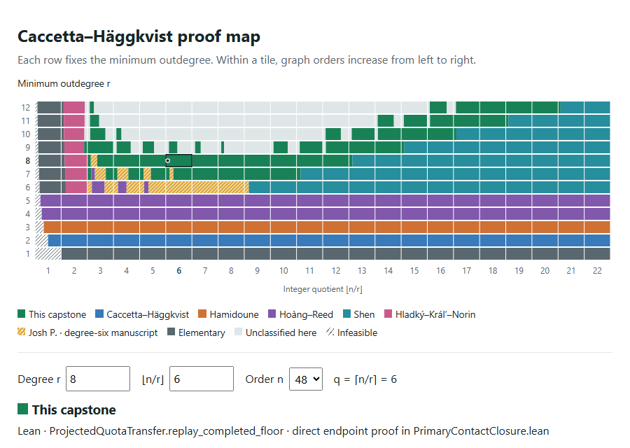

# Caccetta–Häggkvist in Lean

This repository develops the [full recursive capstone](checkpoints/shen_extension/Capstone.lean). For arbitrary positive order `n` and minimum outdegree `r`, the goal is a directed cycle of length at most ⌈n/r⌉. **The full proof is open.** The [reference replay](evidence/README.md) leaves 48 Lean contexts grouped into 12 obligations.

## Results

**All orders through degree 8.** For every nonempty loopless digraph on n vertices and every integer r with 1 ≤ r ≤ 8, minimum outdegree at least r guarantees a directed cycle of length at most ⌈n/r⌉. This includes the classical cases through degree 5 and the project proofs for degrees 6, 7 and 8. [Lean theorem `degree_one_to_eight`](checkpoints/shen_extension/PublicResults.lean#L8)

**A sharper numerical bound at two orders.** On either 34 or 35 vertices, minimum outdegree at least 9 guarantees a directed cycle of length at most **4**. Liang and Xu’s five-cycle threshold (0.24817n) gives **5** at both orders. Their four-cycle threshold (0.28724n) requires degree 10 at order 34 and degree 11 at order 35. [Lean theorem `degree_nine_at_34_or_35`](checkpoints/shen_extension/PublicResults.lean#L18) · [Liang–Xu five-cycle theorem](https://content.scirp.org/pdf/AM20120700013_11769404.pdf) · [Liang–Xu four-cycle theorem](https://actamath.cjoe.ac.cn/Jwk_sxxb_cn/EN/10.12386/A2013sxxb0049)

[](docs/coverage.html)

[Download the interactive map](https://raw.githubusercontent.com/brielms/caccetta-haggkvist-lean/main/docs/coverage.html) and open it in a browser to inspect exact orders and sources. Green marks coverage from this project beyond the comparison bounds shown. Striped gold marks overlap with [Josh P.’s unpublished degree-six manuscript](https://github.com/joshp123/solve-a-maths-problem-dont-care-which-make-no-mistakes/blob/main/paper/manuscript.md). The [Lean map theorem](docs/CoverageMap.lean) certifies the project exclusions.

### Who closes what

Each cell is one pair (order n, minimum outdegree r) and shows the first source that guarantees a directed cycle of length at most ⌈n/r⌉. Published results come first: [Caccetta–Häggkvist](https://www.sciencedirect.com/science/article/pii/0095895687900098) for r = 2, Hamidoune for r = 3, [Hoàng–Reed](https://www.sciencedirect.com/science/article/pii/0012365X87901221) for r = 4 and 5, [Shen](https://www.sciencedirect.com/science/article/pii/S0012365X99003234) for n ≥ 2r² − 3r + 1 and [Hladký–Král’–Norin](https://arxiv.org/abs/0908.2791) for r ≥ 0.3465n, each also through vertex deletion. Green cells are closed only by this project’s Lean proofs.


`python docs/attribution_grids.py` redraws it from the Lean-printed rows in `docs/coverage.html`, using the same source order as the interactive map.

With [Elan](https://github.com/leanprover/elan), Python 3 and Bash installed, run:

```bash
lake exe cache get
bash checkpoints/shen_extension/check_capstone.sh --build-only
lake env lean checkpoints/shen_extension/PublicResults.lean
bash checkpoints/shen_extension/check_regressions.sh
bash checkpoints/shen_extension/check_capstone.sh --replay
```

The last command currently exits with Lean’s open-goal diagnostic. [GitHub Actions](.github/workflows/replay.yml) checks that the live replay reproduces the named open conclusions and published bounds. See the [worklist guide](checkpoints/shen_extension/RecursiveFamilyWorklist.md) for the rule engine and the [upstream notice](checkpoints/shen_extension/vendor/seymour/README.md) for the vendored Apache-2.0 proof.
