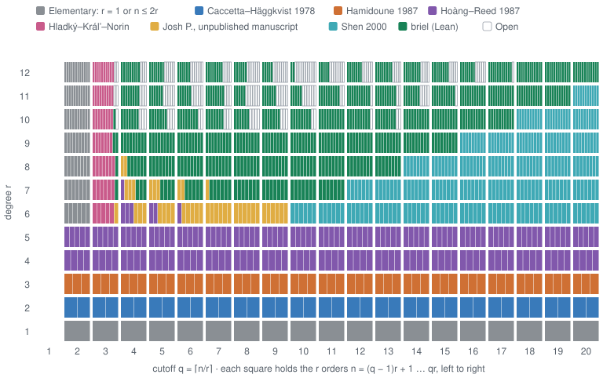

# Caccetta–Häggkvist in Lean

Goal: every loopless digraph on n vertices with minimum outdegree r has a directed cycle of length at most ⌈n/r⌉. **Open.** The [capstone](checkpoints/shen_extension/Capstone.lean) replay leaves [16 Lean contexts](evidence/README.md).

## Results ([Lean](checkpoints/shen_extension/PublicResults.lean))

- CH is proved for all orders n for 1 ≤ r ≤ 9 (`degree_one_to_nine`; degree nine alone is `degree_nine`).
- Extension of the [Shen](https://www.sciencedirect.com/science/article/pii/S0012365X99003234) bound (`beyond_shen`):

| | Degrees | CH holds for |
|---|---|---|
| Shen | every r | n ≥ 2r² − 3r + 1 |
| briel | every r | n ≥ 2r² − 7r + 1 |
| briel | r ≥ 13 | n ≥ 2r² − 8r + 1 |
| briel | r ≥ 6276 | n ≥ 2r² − 9r + 1 |
| briel | r ≥ 424·G² | n ≥ 2r² − G·r + 1 |



Sources: [Caccetta–Häggkvist](https://www.sciencedirect.com/science/article/pii/0095895687900098) · Hamidoune · [Hoàng–Reed](https://www.sciencedirect.com/science/article/pii/0012365X87901221) · [Shen](https://www.sciencedirect.com/science/article/pii/S0012365X99003234) · [Hladký–Král’–Norin](https://arxiv.org/abs/0908.2791) · [Josh P. (unpublished)](https://github.com/joshp123/solve-a-maths-problem-dont-care-which-make-no-mistakes/blob/main/paper/manuscript.md). Each order is credited to the first of these that covers it, and to briel only when none does, so the Lean proofs also cover many orders shown under an earlier name. The comparison is with these sources only. The briel orders are certified by [CoverageMap.lean](docs/CoverageMap.lean).

## Also proved

Every theorem named here is in the [same file](checkpoints/shen_extension/PublicResults.lean), with the standard axioms only. In the first two tables D is a loopless digraph on n ≥ 1 vertices with minimum outdegree r.

**Strips below the Shen range.** Write q = 2r − g. D has a directed cycle of length at most q when n is at most the bound, rounded down:

| Theorem | Gaps g | Largest n |
|---|---|---|
| `strip_window` | 1 ≤ g, 3g ≤ 2r | q·r − (g − 1)²/2 |
| `strip_window_eighth` | 2g + 2 ≤ r, g² ≤ 8r | q·r − ((g + 2)² + 1)/8 |
| `strip_window_tight` | 1 ≤ g, 3g ≤ 2r | q·r for g ≤ 3; q·r − g(g − 3)/2 for g ≥ 4; for even g ≥ 4 also q·r + 1 − (g − 2)²/2 |
| `strip_window_eighth_tight` | 2g + 2 ≤ r, g² ≤ 8r | q·r − (g(g + 4) − 7)/8 |

**Rows near r = q.** D has a directed cycle of length at most q when n is at most the bound, a computable function of q:

| Theorem | Degree | Largest n |
|---|---|---|
| `flat_row` | r = q | `FlatRule.flatBound q` |
| `collar_row` | r = q + 1 | `CollarRule.collarBound q` |
| `tight_row` | r = q + 2 | `TightRule2.tightBound2 q` |
| `thin_row` | any r | `ThinRule.thinBound q r` |

**Laws from the degree-nine proof, for every q.** These closed the last orders at r = 9 and are stated with q free. D is a digraph on N vertices with no directed cycle of length at most q.

- Fragment budget (`fragment_budget`). Every vertex has at least 2 + t out-neighbours and each vertex of a set S has exactly r, with r + 2 ≤ 2q and r + 1 + t ≤ N. For radii i, j ≥ 3 with i + j ≤ q: N·(2(i + j) + 2t) + 2·|S|·(r + 3 − (i + j)) ≤ N·(N − 1).
- Full row (`full_row`). Same setting with r + 5 ≤ 2q. A vertex with exactly r out-neighbours reaches at least r + 5 + t other vertices within i steps, for each i ≥ 4.
- Equal layers (`equal_layers`). Let u ≠ v have the same set of vertices at distance exactly j, with 2j ≤ q + 2 and v within q steps of u. Then every vertex within j − 1 steps of v is within j − 1 steps of u, and is not u.
- Row r = q + 3, q ≥ 6 (`supplier_row`). Every outdegree is q + 3, and u has q + 3 vertices at distance two and q + 2 at distance three. Take the vertices whose out-neighbours are that third layer plus one more vertex, which itself points to all of the layer. At least two of them reach 3(q + 3) or more other vertices within three steps.
- Row r = q + 1, q ≥ 8 (`layer_profile_row`). Every outdegree is q + 1. No vertex has exactly q + 2, q and q vertices at distances two, three and four.

**The coverage map.** CH holds at every (n, r) whose cell in the map is nonzero (`of_covered_cell`); this is what the picture above draws. [Interactive map](docs/coverage.html).

## Research notes

- [Counterexample to the joint in-degree and second out-neighborhood bound (GD)](docs/gd-counterexample.md).

## Check

```bash
lake exe cache get
bash checkpoints/shen_extension/check_capstone.sh --build-only
lake env lean checkpoints/shen_extension/PublicResults.lean
bash checkpoints/shen_extension/check_capstone.sh --replay   # exits 1: the open goals
```

Vendored Apache-2.0 proof: [notice](checkpoints/shen_extension/vendor/seymour/README.md).
