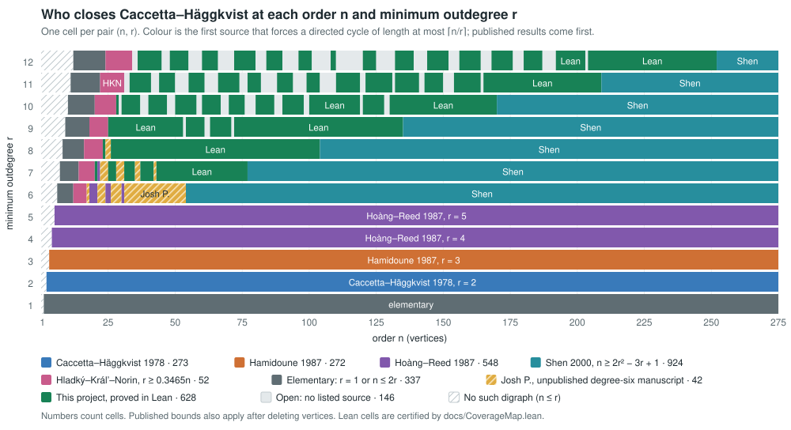

# Caccetta–Häggkvist in Lean

Goal: every loopless digraph on n vertices with minimum outdegree r has a directed cycle of length at most ⌈n/r⌉. **Open.** The [capstone](checkpoints/shen_extension/Capstone.lean) replay leaves [48 Lean contexts](evidence/README.md).

## Results ([Lean](checkpoints/shen_extension/PublicResults.lean))

- All orders n for 1 ≤ r ≤ 8 (`degree_one_to_eight`).
- n = 34 or 35 with r = 9: a cycle of length at most 4 (`degree_nine_at_34_or_35`). [Liang–Xu](https://content.scirp.org/pdf/AM20120700013_11769404.pdf) give 5.
- Every (n, r) with a nonzero cell in the coverage map (`of_covered_cell`), and every (n, r) with ⌈n/r⌉ > 2r − 6 (`above_top_strip`).
- r = 9: every n except 36, 44, 45, 54, 59–63, 67–72, 77–81, 88–90, 98, 99 and 108 (`degree_nine_except`).



Sources: [Caccetta–Häggkvist](https://www.sciencedirect.com/science/article/pii/0095895687900098) · Hamidoune · [Hoàng–Reed](https://www.sciencedirect.com/science/article/pii/0012365X87901221) · [Shen](https://www.sciencedirect.com/science/article/pii/S0012365X99003234) · [Hladký–Král’–Norin](https://arxiv.org/abs/0908.2791) · [Josh P. (unpublished)](https://github.com/joshp123/solve-a-maths-problem-dont-care-which-make-no-mistakes/blob/main/paper/manuscript.md). Lean cells are certified by [CoverageMap.lean](docs/CoverageMap.lean); [interactive map](docs/coverage.html).

## Check

```bash
lake exe cache get
bash checkpoints/shen_extension/check_capstone.sh --build-only
lake env lean checkpoints/shen_extension/PublicResults.lean
bash checkpoints/shen_extension/check_capstone.sh --replay   # exits 1: the open goals
```

Vendored Apache-2.0 proof: [notice](checkpoints/shen_extension/vendor/seymour/README.md).
